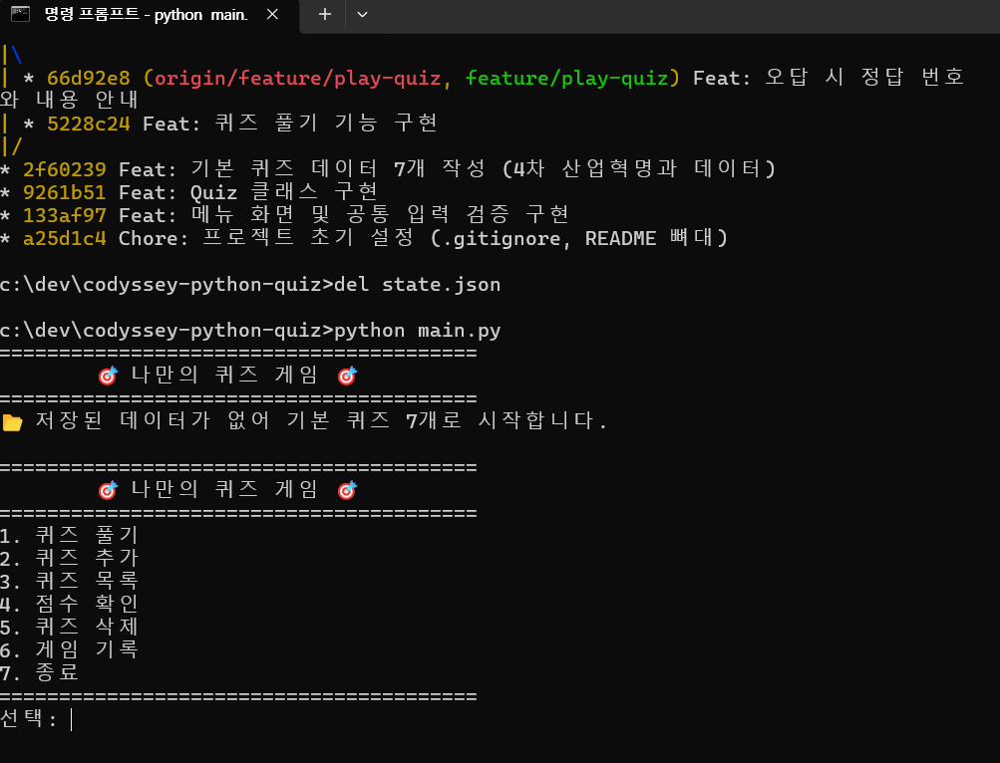
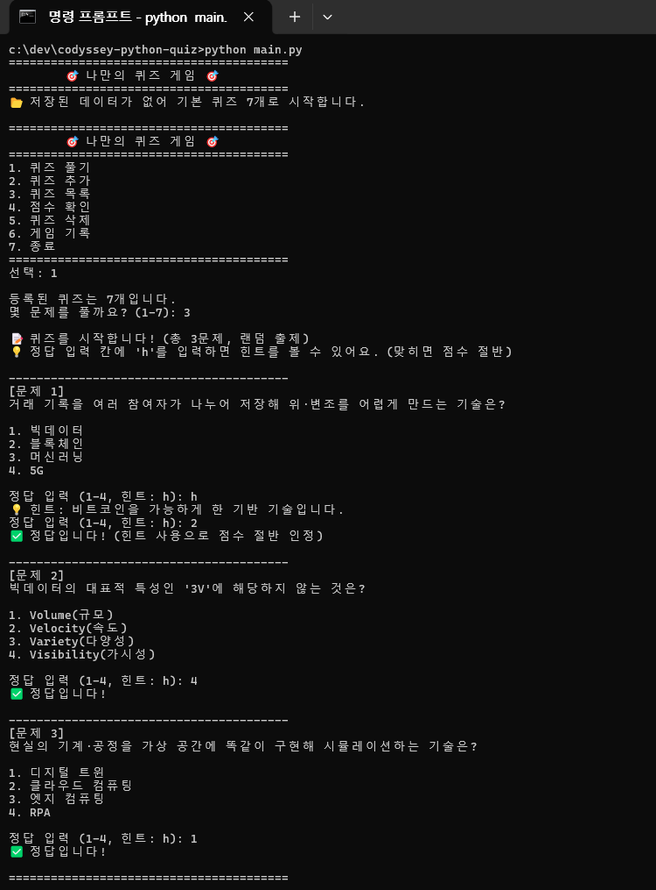
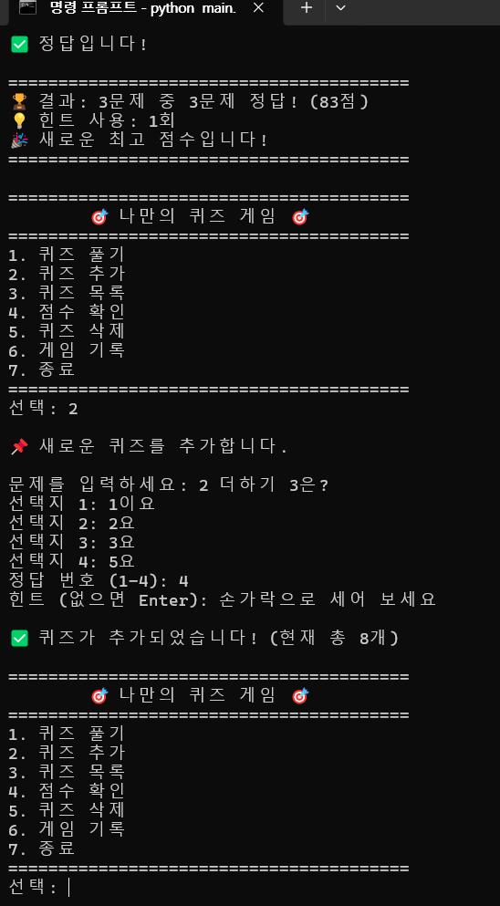
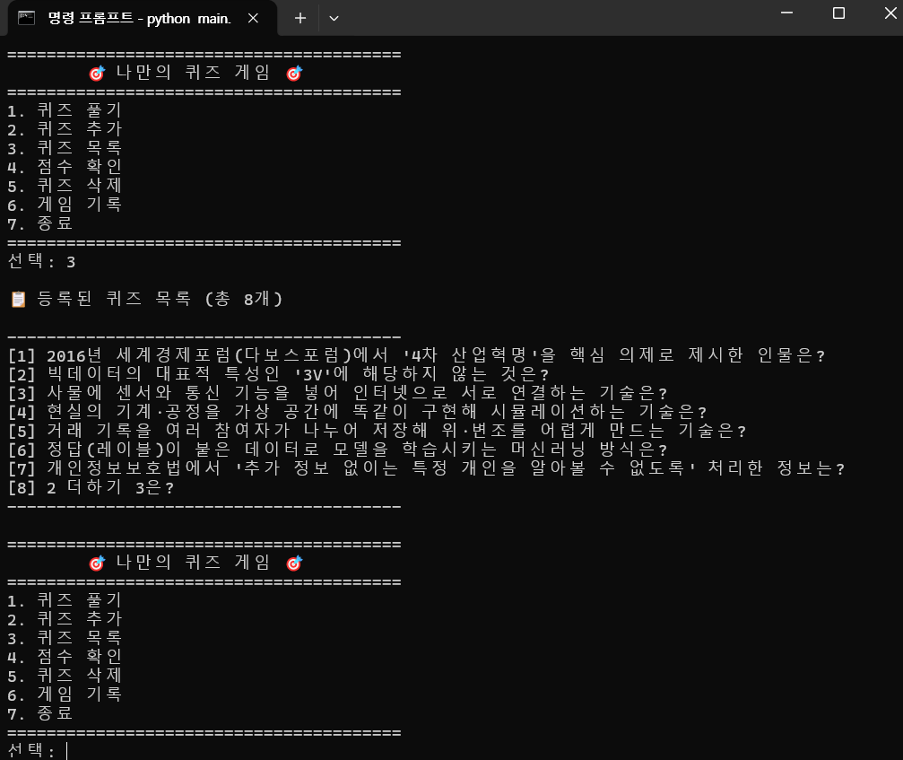
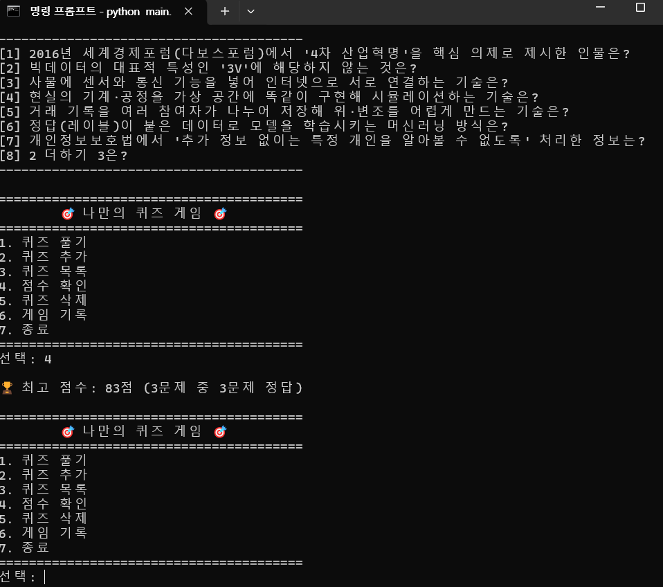
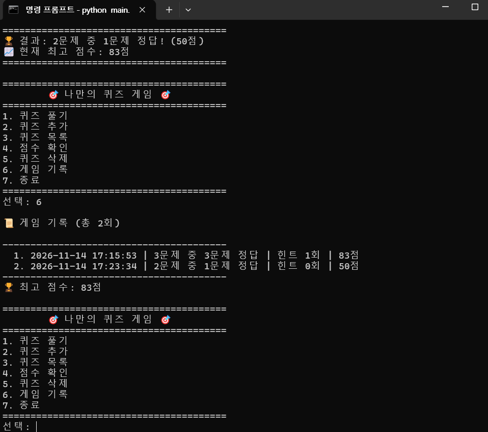
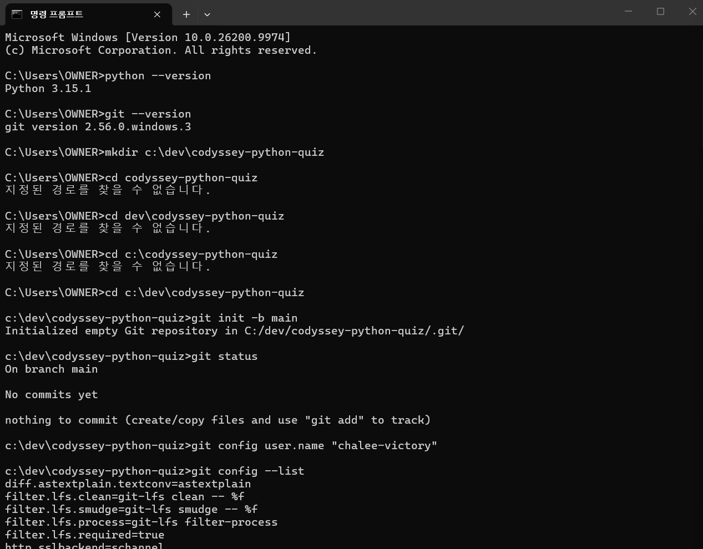
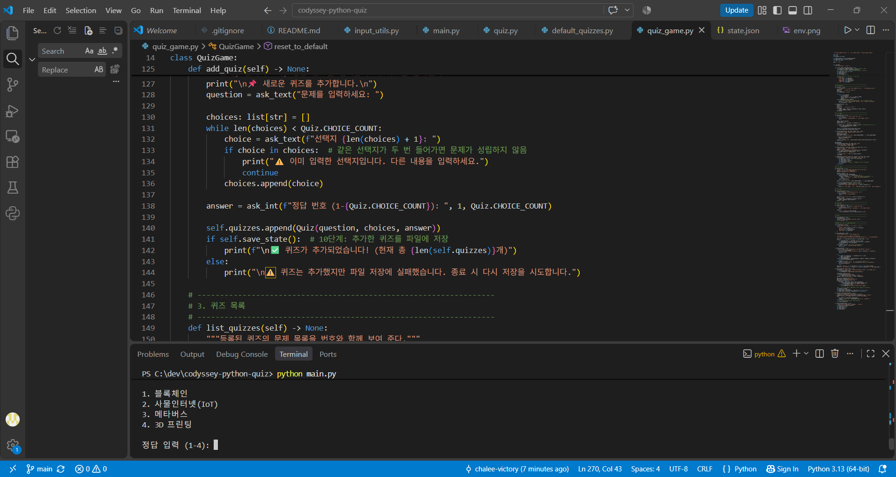
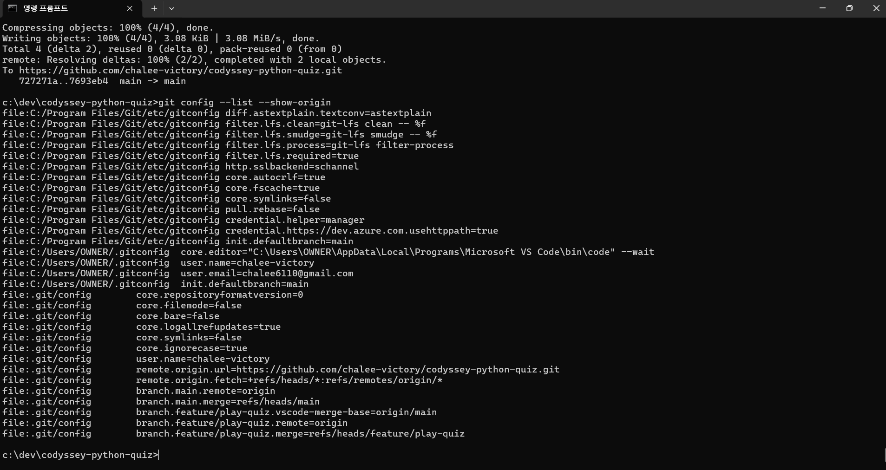
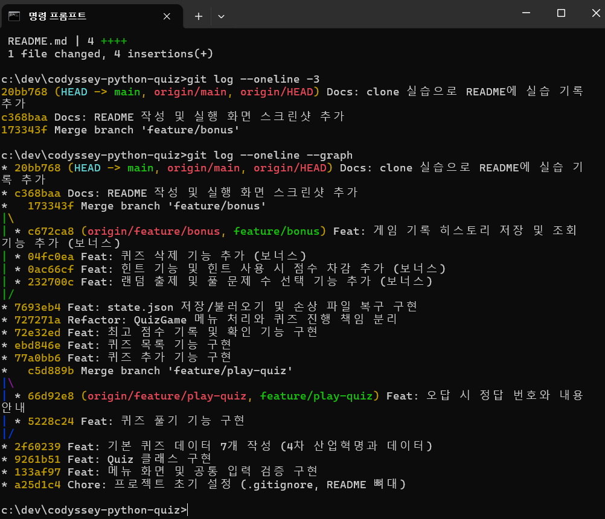

# 🎯 나만의 퀴즈 게임 (Python 콘솔)

터미널에서 동작하는 4지선다 퀴즈 게임입니다.
Python 기본 문법, 클래스(객체 지향), JSON 파일 저장, Git 브랜치 워크플로우를 처음부터 끝까지 직접 적용해 본 Codyssey 미션 결과물입니다.

---

## 1. 프로젝트 개요

| 항목 | 내용 |
|---|---|
| 형태 | Python 콘솔(터미널) 프로그램 |
| 개발 환경 | Python 3.10 이상 (개발: Python 3.15.1), Git 2.56, Windows 11, VS Code |
| 외부 라이브러리 | 없음 (표준 라이브러리 `json`, `os`, `random`, `datetime`, `pathlib`만 사용) |
| 핵심 구조 | `Quiz`(퀴즈 1문제) / `QuizGame`(게임 전체 관리) 두 클래스로 역할 분리 |
| 데이터 저장 | 프로젝트 루트의 `state.json` (UTF-8) — 종료 후 다시 실행해도 퀴즈·최고 점수·기록 유지 |

메뉴에서 번호를 고르면 퀴즈 풀기 / 추가 / 목록 / 점수 확인 / 삭제 / 게임 기록 / 종료 기능이 실행됩니다.
잘못된 입력(공백, 문자, 범위 밖 숫자, 빈 입력), `Ctrl+C`, 입력 종료(EOF), 손상된 데이터 파일 등 예외 상황에서도 프로그램이 비정상 종료되지 않도록 만들었습니다.

---

## 2. 퀴즈 주제와 선정 이유

**주제: 4차 산업혁명과 데이터**

- 대학에서 4차 산업혁명과 데이터 관련 강의를 하고 있어, 수업에서 다루는 핵심 개념(빅데이터 3V, IoT, 디지털 트윈, 블록체인, 머신러닝, 가명정보)을 학습자가 스스로 점검할 수 있는 도구로 쓰기 위해 선정했습니다.
- 데이터거래사로서 실무에서 자주 접하는 개념(가명정보 등 개인정보 처리 용어)을 문제로 만들어, 기술 용어와 제도를 함께 익힐 수 있게 했습니다.
- 각 문제에 힌트를 붙여, 정답을 맞히는 것보다 개념을 떠올리는 과정에 도움이 되도록 구성했습니다.

---

## 3. 실행 방법

```bash
# 1) 저장소 복제
git clone https://github.com/chalee-victory/codyssey-python-quiz.git
cd codyssey-python-quiz

# 2) 실행 (Python 3.10 이상)
python main.py
```

- 처음 실행하면 `state.json`이 없으므로 기본 퀴즈 7개로 시작하고, 파일이 자동으로 만들어집니다.
- 처음부터 다시 시작하고 싶으면 `state.json`을 삭제한 뒤 실행하면 됩니다.

---

## 4. 기능 목록

### 필수 기능

| 메뉴 | 기능 | 설명 |
|---|---|---|
| 1 | 퀴즈 풀기 | 퀴즈를 출제하고 정답/오답을 즉시 알려 줌. 오답이면 정답 번호와 내용을 안내. 끝나면 정답 수와 100점 환산 점수 표시. 퀴즈가 없으면 안내 |
| 2 | 퀴즈 추가 | 문제, 선택지 4개, 정답 번호(1~4)를 입력받아 등록하고 즉시 파일에 저장. 빈 입력·중복 선택지·잘못된 번호는 다시 입력받음 |
| 3 | 퀴즈 목록 | 등록된 퀴즈를 번호와 함께 출력. 퀴즈가 없으면 안내 |
| 4 | 점수 확인 | 최고 점수와 정답 수 표시. 퀴즈를 풀 때마다 비교·갱신하여 파일에 저장. 아직 풀지 않았으면 안내 |
| 7 | 종료 | 데이터를 저장하고 종료 |

### 보너스 기능

| 기능 | 설명 |
|---|---|
| 랜덤 출제 | `random.sample`로 원본 목록을 바꾸지 않고 무작위 순서로 출제 |
| 문제 수 선택 | 풀이 시작 시 1~전체 개수 중 몇 문제를 풀지 선택 |
| 힌트 | 정답 입력 칸에 `h`를 입력하면 힌트 표시. 힌트를 보고 맞힌 문제는 **0.5문제**로 계산해 점수 차감 |
| 퀴즈 삭제 (메뉴 5) | 목록에서 번호 선택(0: 취소) → y/n 확인 후 삭제, 파일에 즉시 반영 |
| 게임 기록 (메뉴 6) | 매 게임의 날짜·시간, 푼 문제 수, 정답 수, 힌트 횟수, 점수를 모두 저장하고 조회 |

### 입력·예외 처리

| 상황 | 처리 |
|---|---|
| 입력 앞뒤 공백 (` 1 `) | `strip()`으로 제거 후 처리 |
| 숫자가 아닌 입력 (`abc`) | 안내 메시지 출력 후 다시 입력 |
| 범위 밖 숫자 (메뉴 `9`, 정답 `0`) | 안내 메시지 출력 후 다시 입력 |
| 빈 입력 (Enter) | 안내 메시지 출력 후 다시 입력 |
| `Ctrl+C` / 입력 종료(EOF) | 안내 메시지 출력, 데이터 저장 후 안전하게 종료 |
| `state.json` 없음 | 기본 퀴즈로 시작하고 파일 생성 |
| `state.json` 손상 (JSON 문법 오류, 필드 누락, 잘못된 값) | 안내 메시지 출력, `state.json.broken`으로 백업 후 기본 데이터로 복구 |
| 파일 읽기/쓰기 오류 | `try/except`로 처리하여 안내 후 계속 진행 |

---

## 5. 파일 구조

```
codyssey-python-quiz/
├── main.py              # 실행 진입점: state.json 경로를 정하고 QuizGame 실행
├── quiz_game.py         # QuizGame 클래스: 메뉴, 풀기·추가·목록·점수·삭제·기록, 저장/불러오기
├── quiz.py              # Quiz 클래스: 문제·선택지 4개·정답·힌트, 출력/정답 확인/JSON 변환
├── default_quizzes.py   # 기본 퀴즈 7개 (파일이 없거나 손상됐을 때 사용)
├── input_utils.py       # 공통 입력 검증 함수 (ask_int, ask_text, ask_int_or_command, ask_yes_no)
├── state.json           # 실행 중 자동 생성되는 데이터 파일 (Git에는 올리지 않음)
├── .gitignore           # __pycache__, state.json 등 제외 목록
├── README.md
└── docs/
    └── screenshots/     # 개발 환경 및 실행 화면 스크린샷
```

### 클래스 설계

| 클래스 | 역할 | 주요 속성 | 주요 메서드 |
|---|---|---|---|
| `Quiz` | 퀴즈 1문제 | `question`, `choices`, `answer`, `hint` | `display()`, `is_correct()`, `to_dict()`, `from_dict()` |
| `QuizGame` | 게임 전체 관리 | `quizzes`, `best_score`, `history`, `menu`, `state_path` | `run()`, `play_quiz()`, `add_quiz()`, `list_quizzes()`, `show_score()`, `delete_quiz()`, `show_history()`, `save_state()`, `load_state()` |

### 왜 클래스를 사용했나 (함수만 쓰는 방식과 비교)

게임에는 **계속 기억해야 하는 상태**(퀴즈 목록, 최고 점수, 기록, 실행 여부)가 있습니다.
`QuizGame` 클래스로 만들면 이 상태를 `self.quizzes`, `self.best_score` 같은 **속성**으로 한곳에 두고, 풀기·추가·저장 같은 **메서드**가 `self`를 통해 같은 데이터를 함께 씁니다.
`Quiz` 클래스는 문제·선택지·정답이라는 **데이터와 그 데이터를 다루는 기능**(출력, 정답 확인, JSON 변환, 생성 시 유효성 검사)을 한 덩어리로 묶어, 잘못된 퀴즈가 만들어지지 않게 합니다.

| 비교 | 함수만 사용 | 클래스 사용 (이 프로젝트) |
|---|---|---|
| 상태 보관 | 전역 변수를 쓰거나 매번 매개변수로 넘겨야 함 | 객체 속성(`self.xxx`)에 보관 |
| 코드 구조 | 데이터와 기능이 흩어짐 | 데이터 + 기능이 한 덩어리 (캡슐화) |
| 유효성 검사 | 사용하는 곳마다 반복 | `Quiz.__init__` 한 곳에서 처리 |
| 기능 추가 | 관련 함수를 찾아 여러 곳 수정 | `QuizGame`에 메서드 추가 + 메뉴 표에 한 줄 추가 |
| 단점 | — | 작은 프로그램에서는 코드가 조금 길어짐 |

`input_utils.py`는 기억할 상태 없이 "입력받아 검사 후 돌려주기"만 하므로 클래스가 아닌 **함수**로 두었습니다.
즉, **입력 검증(`input_utils`) – 데이터 표현(`Quiz`) – 게임 흐름과 파일 입출력(`QuizGame`)**으로 책임을 나눴습니다.

---

## 6. 데이터 파일 설명 (`state.json`)

- **경로:** 프로젝트 루트 `state.json` (`main.py`가 있는 폴더 기준으로 계산하므로 어느 폴더에서 실행해도 같은 파일 사용)
- **인코딩:** UTF-8 (`ensure_ascii=False`로 한글을 그대로 저장)
- **역할:** 퀴즈 목록, 최고 점수, 게임 기록을 저장하여 프로그램을 다시 실행해도 유지
- **저장 시점:** 퀴즈 추가·삭제, 퀴즈 풀이 완료, 종료, `Ctrl+C`/EOF 발생 시
- **안전 저장:** 임시 파일(`state.json.tmp`)에 먼저 쓴 뒤 `os.replace`로 교체하여, 저장 도중 끊겨도 기존 파일이 깨지지 않게 함
- **Git 제외:** 사용자마다 내용이 달라지는 실행 데이터이므로 `.gitignore`에 등록

### 스키마

| 키 | 타입 | 설명 |
|---|---|---|
| `quizzes` | list | 퀴즈 목록 |
| `quizzes[].question` | str | 문제 |
| `quizzes[].choices` | list[str] | 선택지 4개 |
| `quizzes[].answer` | int | 정답 번호 (1~4) |
| `quizzes[].hint` | str | 힌트 (없으면 빈 문자열) |
| `best_score` | int 또는 null | 최고 점수 (0~100), 아직 풀지 않았으면 `null` |
| `best_correct` | int | 최고 점수일 때 맞힌 문제 수 |
| `best_total` | int | 최고 점수일 때 푼 문제 수 |
| `history` | list | 게임 기록 (보너스) |
| `history[].played_at` | str | 플레이 일시 (`YYYY-MM-DD HH:MM:SS`) |
| `history[].total` / `correct` / `hints_used` / `score` | int | 푼 문제 수 / 정답 수 / 힌트 사용 횟수 / 점수 |

### 예시

```json
{
    "quizzes": [
        {
            "question": "빅데이터의 대표적 특성인 '3V'에 해당하지 않는 것은?",
            "choices": ["Volume(규모)", "Velocity(속도)", "Variety(다양성)", "Visibility(가시성)"],
            "answer": 4,
            "hint": "'보이는 정도'는 빅데이터의 원래 3V가 아닙니다."
        }
    ],
    "best_score": 83,
    "best_correct": 3,
    "best_total": 3,
    "history": [
        {
            "played_at": "2026-11-14 17:20:00",
            "total": 3,
            "correct": 3,
            "hints_used": 1,
            "score": 83
        }
    ]
}
```

### JSON을 선택한 이유

- 사람이 메모장으로 열어 읽고 고칠 수 있는 **텍스트 형식**입니다.
- 리스트·딕셔너리 구조를 그대로 저장할 수 있어 `퀴즈 목록 → 각 퀴즈(dict)` 구조와 잘 맞습니다.
- Python 표준 라이브러리 `json`만으로 읽고 쓸 수 있어 외부 라이브러리 금지 조건에 맞습니다.

### JSON 방식의 한계와 대안

| 한계 | 설명 |
|---|---|
| 성능 | 퀴즈 1개만 바꿔도 **파일 전체를 다시 씀**. 데이터가 많아질수록 저장 시간이 늘어남 |
| 메모리 | 실행할 때 **파일 전체를 한 번에 메모리로 읽음**. 기록(`history`)이 계속 쌓이면 메모리 사용량이 커짐 |
| 동시 접근 | 여러 프로그램이 동시에 쓰면 내용이 덮어써질 수 있음 (잠금 기능 없음) |
| 검색 | "점수 80점 이상 기록만" 같은 조건 검색 기능이 없어 전부 읽은 뒤 코드로 걸러야 함 |
| 손상 위험 | 일부만 깨져도 전체를 못 읽음 → 이 프로젝트는 임시 파일 교체 저장과 `.broken` 백업으로 보완 |

**대안:** 데이터가 커지면 표준 라이브러리 `sqlite3`(파일 하나짜리 데이터베이스)로 바꾸면, 필요한 행만 읽고 쓰거나 조건 검색을 할 수 있습니다. 지금처럼 퀴즈 수십 개·기록 수백 개 수준에서는 JSON이 가장 단순하고 충분합니다.

---

## 7. 실행 화면

| 화면 | 스크린샷 |
|---|---|
| 메뉴 |  |
| 퀴즈 풀기 (힌트 사용) |  |
| 퀴즈 추가 |  |
| 퀴즈 목록 |  |
| 점수 확인 |  |
| 게임 기록 (보너스) |  |

### 개발 환경

| 항목 | 스크린샷 |
|---|---|
| Python·Git 버전 |  |
| VS Code |  |
| Git 설정 |  |

---

## 8. Git 작업 방식

### 커밋 규칙과 대표 커밋

기능 단위로 커밋하고, 메시지 앞에 종류를 붙였습니다. (`Feat:` 기능, `Refactor:` 구조 개선, `Docs:` 문서, `Chore:` 설정)

```
Chore: 프로젝트 초기 설정 (.gitignore, README 뼈대)
Feat: Quiz 클래스 구현
Feat: 퀴즈 풀기 기능 구현                       (feature/play-quiz 브랜치)
Refactor: QuizGame 메뉴 처리와 퀴즈 진행 책임 분리
Feat: state.json 저장/불러오기 및 손상 파일 복구 구현
Feat: 힌트 기능 및 힌트 사용 시 점수 차감 추가 (보너스)   (feature/bonus 브랜치)
Docs: README 작성 및 실행 화면 스크린샷 추가
```

### 브랜치를 나눈 이유

- `main`은 **항상 실행 가능한 상태**로 유지하고, 새 기능은 별도 브랜치에서 개발했습니다.
- `feature/play-quiz`: 게임의 핵심인 퀴즈 풀기 기능 / `feature/bonus`: 선택 과제(랜덤·힌트·삭제·기록) 4개
- 개발 중 코드가 깨져도 `main`에는 영향이 없고, 실패하면 브랜치만 버리면 됩니다. 팀 작업에서 각자 브랜치로 작업한 뒤 합치는 방식을 연습하는 의미도 있습니다.

### `--no-ff` 병합을 선택한 이유

- 기본 병합은 `main`에 새 커밋이 없으면 **fast-forward**로 브랜치 커밋을 `main`에 그대로 이어 붙여서, 브랜치에서 작업했다는 흔적이 그래프에 남지 않습니다.
- `--no-ff`(no fast-forward)는 항상 **병합 커밋**(`Merge branch 'feature/...'`)을 만들어, 그래프에 "갈라졌다 합쳐진" 모양과 기능 묶음 단위가 남습니다.

| 비교 | fast-forward | `--no-ff` (이 프로젝트) |
|---|---|---|
| 그래프 | 한 줄로 이어짐 | 갈라졌다 합쳐지는 모양 |
| 기능 단위 파악 | 어렵다 | 병합 커밋 하나로 기능 묶음 확인 |
| 되돌리기 | 커밋을 하나씩 되돌려야 함 | 병합 커밋 하나로 기능 전체를 되돌릴 수 있음 |
| 단점 | — | 병합 커밋이 늘어 기록이 조금 길어짐 |

### Git 기록 증빙

- 사용한 Git 명령어: `init`, `add`, `commit`, `push`, `checkout`, `merge`, `clone`, `pull`
- 커밋 20개 이상, 브랜치 2개 생성 후 `main`에 병합 2회

| 항목 | 스크린샷 |
|---|---|
| 커밋 기록·브랜치 병합 그래프 (`git log --oneline --graph --all`) |  |
| 브랜치 목록 (`git branch -a`) |  |
| clone·pull 실행 화면 |  |

---

## 9. clone·pull 실습 기록

1. 별도 폴더에 복제: `git clone https://github.com/chalee-victory/codyssey-python-quiz.git codyssey-clone`
2. 복제본에서 README에 이 문단을 추가 → `commit` → `push`
3. 원래 작업 폴더(`c:\dev\codyssey-python-quiz`)에서 `git pull` → `Fast-forward`로 변경 사항이 반영된 것을 `git log`로 확인
